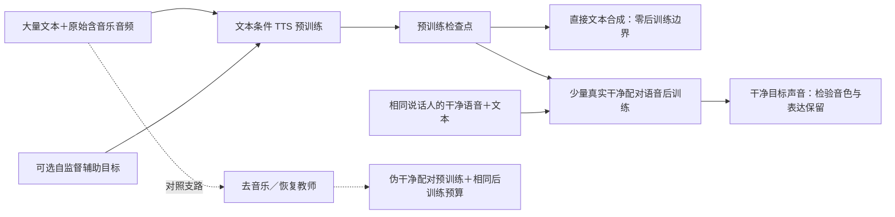

# 含背景音乐配对语料预训练与少量干净语音后训练：单说话人 TTS 调研报告

**调研与修订日期：2026 年 10 月 30 日｜第二版**  
**数据设定：至少 2000 小时原始含背景音乐音频，保证目标说话人唯一，提供对应文本标签；中文为主、少量英文；真实干净语音总量约 1–2 小时，研究目标是进一步减少其使用量；GPU 显存不构成主要约束。**

> **本版主线：大量“文本＋原始含音乐音频”进行 TTS 预训练，学习文本到发音、目标音色及韵律习惯，再用少量“文本＋真实干净语音”后训练，完成干净声学域适配和质量提升。**
>
> 不预先将去音乐处理设为必要步骤。伪干净语音路线作为对照；自监督学习作为可选的辅助目标；零干净、无后训练作为边界实验。本文是文献调研和实验设计，未对用户数据实际训练，不包含声称已经取得的实验结果。

## 1. 结论与研究定位

**这条路线有明确可行性依据，值得作为主实验。**大量原始配对数据可以提供少量干净录音难以覆盖的发音、停顿、语速和表达信息；少量干净配对数据可以使模型向干净输出分布迁移。但“需要多少干净数据、能否保留个体表达、何时会失败”必须通过实验确定。

最重要的修正是：**如果文本标签已参与预训练，第一阶段就应当学习 TTS，而不是等后训练才建立文字与声音的关系。**第一阶段的输出可能仍带音乐；第二阶段主要改善干净声学实现，并修正残留的对齐和发音问题。因此更准确的研究名称是“含音乐配对数据的 TTS 预训练＋少量干净域适配”，而非笼统的“纯自监督预训练＋任务微调”。

本次补查找到三类直接相关证据：

1. **低质量语音预训练后，用高质量语音提高合成质量并保留风格。**Mori 与 Furukawa 的日常对话 TTS 工作直接采用这一顺序；中文对话 TTS 研究也使用低质量大语料预训练与高质量后训练。[Mori 与 Furukawa，2025](https://doi.org/10.1250/ast.e24.35)、[Li 等，Interspeech 2023](https://www.isca-archive.org/interspeech_2023/li23ba_interspeech.pdf)
2. **把大语料中的韵律／风格与高质量声音实现分开学习。**ProsoSpeech、Referee 和 AccentSpeech 提供了相关结构和实验。[ProsoSpeech](https://arxiv.org/abs/2202.07816)、[Referee](https://arxiv.org/abs/2109.03439)、[AccentSpeech](https://arxiv.org/abs/2210.17305)
3. **原始含噪语料可以直接作为 TTS 学习对象，但通常需要处理噪声条件。**DenoiSpeech、DRSpeech 和说话人与噪声解耦研究说明，先统一做增强并非唯一选择。[DenoiSpeech](https://arxiv.org/abs/2012.09547)、[DRSpeech](https://arxiv.org/abs/2203.15683)、[Hsu 等，2019](https://research.google/pubs/disentangling-correlated-speaker-and-noise-for-speech-synthesis-via-data-augmentation-and-adversarial-factorization/)

这些研究**支持训练策略，不等于证明本项目的“2000 小时真实中文、同一说话人、全部预训练音频有音乐、分钟级干净后训练”已经得到验证**。该具体设定的资源曲线和保真边界，是值得研究的部分。

推荐主问题：

> **在不预先替换原始声音细节的条件下，大量含音乐配对语料能否降低干净 TTS 的真实干净语音需求？如何通过后训练去掉背景音乐，同时保留说话人的发音与韵律习惯？**

## 2. 任务、训练阶段与资源口径

### 2.1 数据与学习目标

记原始配对训练集为：

$$\mathcal D_m=\{(t_i,x_i)\},\qquad x_i=s_i+m_i+n_i,$$

其中 t 是文本，s 是目标说话人语音，m 是音乐，n 是其他污染。该加法是简化模型；真实录音可能还含混响、压缩和削波。少量干净集为：

$$\mathcal D_c^{(b)}=\{(t_j,s_j)\},$$

b 表示干净训练分钟数。两阶段不要求逐句配对同一句话的含音乐／干净版本；研究的是生成分布迁移，不是对每条训练录音做监督分离。

| 阶段 | 核心训练信号 | 预期获得的能力 | 不能预先保证的结果 |
|---|---|---|---|
| 原始混合配对预训练 | 文本条件下预测混合音频／声学表示 | 可读性、发音习惯、目标音色、文本相关韵律分布 | 自动去音乐、所有表达都与音乐解耦 |
| 可选自监督辅助 | 遮掩预测、内容一致性等 | 提高表示或数据利用效率 | 单靠重建混合音频就学出干净语音 |
| 少量真实干净后训练 | 文本条件下预测真实干净语音 | 干净声学实现、减少音乐残留、修正错误 | 极少分钟数一定足够、表达一定不被覆盖 |

“音色和习惯较稳定”是合理出发点；语速、重音和停顿更应被理解为**受文本、情绪和场景影响的个人分布**，并非固定不变的参数。

### 2.2 应当区分的四种实验

| 设定 | 第一阶段是否用目标文本 | 是否做干净后训练 | 在本报告中的角色 |
|---|---|---|---|
| 原始混合配对预训练→干净后训练 | 是 | 是，预算 b 可变 | **主线** |
| 伪干净配对预训练→相同干净后训练 | 是，文本与主线相同 | 是，完全相同预算 | 检验增强损伤与清洁度的权衡 |
| 原始混合配对预训练后直接推理 | 是 | 否 | 测量第一阶段能力和零干净边界 |
| 仅音频自监督→干净后训练 | 否 | 是 | 量化预训练文本标签的贡献 |

第一阶段已经使用文本时，后训练可以提高任务对齐，却不应再被描述为唯一的任务对齐来源。零后训练的可读性和输出清洁度也必须分别评价。

### 2.3 “少量干净资源”需要完整记账

目标干净语音用于参数更新、开发选模、推理参考、最终测试的时长分别统计。外部干净语料、预训练声码器、TTS 基础模型、ASR、SSL 模型及分离教师单列。

“只用 5 分钟目标干净语音更新参数”可以成立，即使使用了外部基础模型；但不能据此称整个系统只接触过 5 分钟干净音频。伪干净音频也不能计作真实干净录音。

### 2.4 端到端的范围

主方案要求推理时由文本自动生成目标波形，不串联一个必须工作的后置去音乐器。模型内部可以有文本模型、声学模型和声码器。若要求单一网络联合训练并直接输出波形，可追加 VITS 类实现；是否联合波形训练不应与核心数据策略同时变化，以免难以归因。

## 3. 新增文献：与当前主线最接近的证据

### 3.1 低质量预训练→高质量后训练的直接证据

**Mori 与 Furukawa，2025。**先用 4.1 小时日常对话语料训练 FastSpeech 2，再用 5.5 小时 JSUT 微调；比较全更新和冻结部分文本／韵律模块。清晰度评分由 2.15 提高到 2.84／2.81，对话感由 3.75 保持在 3.70／3.66；纯 JSUT 的清晰度为 3.81。它说明质量提升与风格保留可以同时出现，也显示后训练没有完全弥合质量差距。限制是前后说话人不同、非持续 BGM 专项、干净数据并非分钟级；冻结方案也未明显优于全更新。[正式论文与原文表 1](https://www.jstage.jst.go.jp/article/ast/46/1/46_e24.35/_pdf/-char/en)

**Li 等，Interspeech 2023。**中文自发对话研究以约 180 小时低质量 RAMC 预训练，再用约 6 小时高质量对话语料后训练。作者为保留文本到自发行为的映射、减少噪声影响，重置解码器并提高其学习率。这直接提示：后训练的更新位置是重要变量。但其含行为检测器和伪标签，且高质量语料也参与检测器训练，不等于本项目的最小干净后训练方案。[原文 §2.3–3.1](https://www.isca-archive.org/interspeech_2023/li23ba_interspeech.pdf)

**近期大模型训练实践。**Qwen-Audio-3.0-TTS 报告先建立广泛覆盖，再向更干净、富有表达的子集退火；ZONOS2 官方描述宽松纳入原始数据后，逐阶段加强转写和质量筛选。两者支持“覆盖优先、质量后移”的策略，但都不能证明强音乐单说话人仅用几分钟干净数据足够，也不能把所有增益归因于质量退火。[Qwen 原文 §2.2.2](https://arxiv.org/html/2607.23938)、[ZONOS2 官方训练说明](https://www.zyphra.com/research/zonos2)

### 3.2 新增相关方法与资源边界

| 工作 | 可借鉴内容 | 不能外推的结论 |
|---|---|---|
| [ProsoSpeech，ICASSP 2022](https://arxiv.org/abs/2202.07816) | 低质量数据预训练量化韵律表示和预测器，再用高质量 TTS 数据微调 | 使用约 300 小时中文低质量语音、约 30 小时 TTS 语料；不是分钟级干净结果；低频表示也不天然免疫音乐 |
| [Referee，2021 预印本](https://arxiv.org/abs/2109.03439) | 从低质量语料学文本到风格，高质量目标数据学风格到波形 | 实验中的低质量风格语料约 28.8 小时，高质量目标语料约 14 小时；是跨说话人风格迁移 |
| [AccentSpeech，ISCSLP 2022](https://www.colips.org/conferences/iscslp2022/Proceedings/papers/ISCSLP2022_P052.pdf) | 用瓶颈表示划分口音与高质量声音实现 | 最终采用三阶段结构，保留专业目标人的韵律；并非证明从普通含噪语音学到的所有韵律都应保留 |
| [AdaSpeech 3，Interspeech 2021](https://www.isca-archive.org/interspeech_2021/yan21d_interspeech.pdf) | 分别处理填充停顿、时长／音高和音色，说明表达可模块化适配 | 方向主要是朗读模型向自发风格适配，与本项目质量迁移方向不同 |
| [DenoiSpeech，ICASSP 2021](https://arxiv.org/abs/2012.09547) | 帧级噪声条件与文本生成联合学习，不必先把所有目标音频增强后替换 | 噪声提取器使用合成配对监督；合成多说话人实验还包含干净说话人，不是全系统完全无干净资源 |
| [Rep2wav，2023](https://arxiv.org/abs/2308.14553) | 文本到 SSL 表示与表示到波形分开，比较噪声鲁棒性和音色保留 | 原实验仍先增强目标语音，并用外部干净 LibriTTS 训练声码器；不能把它写成无需增强的直接证据 |

Rep2wav 还报告了较高层表示抑制噪声时可能损失说话人信息。这与“保留原始细节”的动机相关，但并不推出所有增强或瓶颈表示都一定更差。应在相同干净预算下比较最终生成质量，而不只比较预处理音频听感。[Rep2wav 原文 §3–4](https://arxiv.org/pdf/2308.14553)

DenoiSpeech 的原文与源文件核对显示：一部分 VCTK 说话人被加入噪声，其他说话人仍提供干净条件；噪声提取器也接受已知背景的合成监督。因此“目标人只有含噪录音”与“训练全程没有任何干净先验”必须分开。[DenoiSpeech 原文 §2.2、§3.1](https://arxiv.org/pdf/2012.09547)

### 3.3 原有相关研究的重新定位

以下工作仍然相关，但其中无转写适配、推理引导和去音乐教师不再是本版主方案。表中的差异是本报告的判断；预印本按作者报告理解。

| 工作 | 已有方法与证据 | 与当前主线的关系、证据限制 |
|---|---|---|
| [背景音乐广播数据 TTS，Bae 等，ICASSP 2021](https://arxiv.org/abs/2103.03049) | 音乐过滤器＋GST＋辅助质量分类器，联合使用过滤语音和真实干净语音 | 覆盖背景音乐场景，但先过滤再混合训练；不是原始混合配对预训练→分钟级干净适配 |
| [说话人与噪声解耦，Hsu 等，ICASSP 2019](https://research.google/pubs/disentangling-correlated-speaker-and-noise-for-speech-synthesis-via-data-augmentation-and-adversarial-factorization/) | 因子化潜变量、噪声增强和对抗因子化，处理说话人与录音条件相关 | “音色和背景解耦”已有系统研究，不能直接作为新贡献 |
| [AdaSpeech 2，ICASSP 2021](https://arxiv.org/abs/2104.09715) | 将 mel 编码器与已有音素编码器空间对齐，再用无转写音频重建适配解码器 | 为保留文本入口、只用音频适配提供先例；未直接解决持续强音乐污染 |
| [Guided-TTS，ICML 2022](https://proceedings.mlr.press/v162/kim22d.html) | 无条件语音生成模型＋外部音素分类器指导采样 | 属于无需目标转写的旁支；本版已有文本标签，不再需要优先采用推理引导 |
| [Guided-TTS 2，2022 预印本](https://arxiv.org/abs/2205.15370) | 说话人条件扩散模型，支持无转写适配，也报告零样本设置 | 不能把“无目标转写也能 TTS”当作新发现；少量无转写适配不等于强音乐下无需干净数据 |
| [无标注预训练迁移框架，Kim 等，Interspeech 2022](https://www.isca-archive.org/interspeech_2022/kim22c_interspeech.pdf) | 使用 wav2vec 2.0 表征进行无标注音频预训练，随后迁移到文本条件 | 两阶段迁移已有先例；论文报告过 10 分钟标注数据的单说话人实验 |
| [DRSpeech，Interspeech 2022](https://arxiv.org/abs/2203.15683) | 帧级和句级声学表征分别建模时变噪声与环境失真 | 为混合录音中的不同污染提供建模思路；未直接验证本项目的两阶段分钟级适配 |
| [UnitSpeech，Interspeech 2023](https://www.isca-archive.org/interspeech_2023/kim23k_interspeech.pdf) | 自监督单元编码器连接已有扩散 TTS，无转写适配共享解码器 | 为无转写辅助对照提供方法；不能替代主线中现有文本标签的监督 |
| [DINO-VITS，Interspeech 2024](https://arxiv.org/html/2311.09770) | 自监督说话人目标与合成目标联合训练；使用 HuBERT 单元研究含噪无转写训练 | 支持自监督辅助与含噪生成研究；其多说话人先验和无转写实验不等于当前配对两阶段方案 |
| [SpeechFlow，ICLR 2024](https://arxiv.org/html/2310.16338) | 无转写音频的生成式 flow matching 预训练，后续适配合成、增强、分离 | 为自监督辅助提供证据；主线还需直接使用配对标签，不能把迁移收益当作去音乐证明 |
| [Flow matching TTS 噪声鲁棒性，Wang 等，Interspeech 2024](https://www.isca-archive.org/interspeech_2024/wang24v_interspeech.pdf) | 无监督预训练、数据过滤、遮掩去噪和含噪提示微调 | 已覆盖相当多自然想到的鲁棒训练组件；主要研究零样本提示的噪声鲁棒性 |
| [SSL adapters，Fujita 等，ICASSP 2024](https://arxiv.org/abs/2401.05111) | SSL 编码器中的 adapter 与含噪参考 TTS 训练，并结合增强前端 | 适合说话人条件分支；不等于解决生成目标本身有音乐的问题 |
| [Stable-TTS，2024 预印本](https://arxiv.org/html/2412.20155) | 高质量先验样本、韵律提示和先验保持损失，稳定有限含噪数据适配 | 可借鉴防遗忘，但不能据此声称一定保留目标人的独特韵律 |
| [离散声学 token 去噪，Lu 等，Interspeech 2025](https://arxiv.org/abs/2505.13830) | 在 codec token 和嵌入层处理含噪提示，接入 LauraTTS | 提醒我们：波形去音乐并非唯一选项，离散表示本身也需检查 |
| [TITW，2024 预印本／Interspeech 2025 论文](https://arxiv.org/abs/2409.08711) | 为真实环境 TTS 构建 Hard/Easy 数据，Easy 增加增强与筛选 | 适合作为外部压力测试；“真实脏数据训练 TTS”已经有公开基准 |
| [Miipher，WASPAA 2023](https://research.google/pubs/miipher-a-robust-speech-restoration-model-integrating-self-supervised-speech-representation-and-linguistic-features/) | 用 SSL 与语言特征恢复网络语音，支持下游 TTS 数据清洗 | 说明应以“清洗后训练效果”评价教师；使用外部监督不能隐去 |
| [Sidon，2025 预印本／ICASSP 2026](https://arxiv.org/html/2509.17052) | 开源多语种语音恢复，并评价清洗语料对下游 TTS 的帮助 | 是当前应比较的恢复教师候选；目标中文、强 BGM 与音色保真需实测 |
| [TTSOps，2025](https://arxiv.org/abs/2506.15614) | 根据下游训练效用动态选择清洗方法和语料 | 不能把“动态选原音频或清洗音频”本身称为首次提出 |
| [SPFM，2025 预印本](https://arxiv.org/html/2509.19091) | 比较条件／无条件损失，识别不可靠标签；有 TITW 实验 | 可借鉴文本标签可靠性处理，但转写错误与音频背景音乐是不同问题 |
| [Qwen-Audio-3.0-TTS，2026 技术报告](https://arxiv.org/html/2607.23938) | 多阶段训练含高质量数据退火、冻结 LM 的声学鲁棒训练 | 支持阶段化训练；干净提示鲁棒性与混合生成目标的迁移仍是不同问题 |

## 4. 为什么这条主线成立，又为何不能直接保证成功

### 4.1 预训练提供覆盖，后训练提供干净分布锚点

用混合目标预训练时，模型近似学习 $p_\theta(x\mid t)$；后训练希望得到 $p_{\theta'}(s\mid t)$。预训练并不需要先解决混合分解，才能学到有用的发音与韵律；后训练也不需要重新学习整个中文朗读系统。

这是本研究的核心假设：两个分布共享足够多的语言、音色和表达结构，干净数据只需推动相对有限的变化。**它是有相关文献支持的迁移假设，不是“音乐自然会被模型忽略”的保证。**

当转写准确、语音在音乐中仍可辨识、场景足够多样且模型有合适先验时，这个假设更有希望成立。即使 2000 小时中没有真实干净片段，也不妨碍先学带背景的 TTS；困难在于后续迁移所需资源。

### 4.2 音乐不是必须在第一阶段彻底消除，但也不会自动消失

生成目标包含音乐时，正确建模音乐可能降低训练损失。即使音乐与文字独立，概率生成器也可能学习随机背景；不能用“不同音乐平均抵消”的直觉代替验证。固定节目、音乐与情绪共现时，纠缠还会更强。

少量真实干净数据的作用之一，就是展示“同一人的声音可以没有背景音乐”。它可以为干净输出提供锚点；若发音、音色与音乐已深度混合，修正所需数据就不再很少。

### 4.3 原始语音与伪干净语音的公平比较

原始数据保留了观测信号中的完整细节，也保留音乐和录音缺陷；增强输出可能丢失气声、擦音、细微音色或改变韵律，也可能显著降低学习难度。**两种偏差都存在，最终以相同资源下的干净 TTS 结果判定。**

不能预设全部伪干净输出同等有损，也不能预设更多原始数据一定弥补污染。主路线不做语音替换，但可以使用增强版本辅助切分、对齐或诊断；这些使用必须披露并做去除对照。

### 4.4 保留什么，需要明确检验

| 希望保留的能力 | 可能的污染或后训练风险 | 如何检验 |
|---|---|---|
| 发音、口音与个人咬字 | 音乐遮蔽辅音；干净集过度规范化口音 | 难音素／声调文本、人工发音评价 |
| 音色与发声细节 | 音乐谐波污染；后训练使声音变薄或失去气声 | 跨句音色盲测、不同说话人编码器 |
| 语速、停顿和重音 | 伴奏节拍相关；干净朗读覆盖对话表达 | 说话人风格听评、同文本前后对照、时长统计 |
| 多种情绪与表达 | 干净集只含中性朗读，造成表达遗忘 | 预先留出的风格文本集与多次采样 |
| 干净声音实现 | 背景残留；误删呼吸和发声噪声 | 音乐残留率、独立音质与自然度听评 |

“原来常说得慢”不代表每句话都应该说得慢。目标是保留条件化的个人习惯，而不是冻结所有时长。任何“韵律保真”都需要独立于音质和音色的证据。

### 4.5 自监督应该承担辅助角色

已有文本标签时，最小方案直接训练文本条件 TTS；先证明它有效，再增加遮掩预测、文本—音频内容一致性等辅助项。用相同数据、相同初始化和近似计算量检验增益。

单纯自监督重建混合音频仍会学习音乐；给同一混合片段额外加两种音乐形成的一致性，也不能保证去掉原有音乐。单说话人身份分类还缺少说话人间的辨别信号。WavLM 等预训练表征可以借用，但内容鲁棒不等于完整音色保留。[WavLM](https://arxiv.org/abs/2110.13900)

## 5. 主方案：原始混合配对预训练→少量真实干净后训练

### 5.1 总体结构



先实现不带额外分解模块的两阶段基线；若已有效，再研究噪声条件、韵律保护与数据课程是否进一步降低干净分钟数。主线推理不依赖后置去音乐器。

### 5.2 初始化分成两种设定

**实用主实验：**从公开中文 TTS 检查点开始，在目标原始配对语料上持续预训练，再做干净后训练。该设定降低实现风险；但结果包含外部干净预训练的帮助。

**机制验证：**相同架构从随机初始化或较弱声学先验开始，用目标混合配对数据学习 TTS，再做相同干净适配。它更直接测量原始数据的学习价值，但成本与风险更高。可先用较小模型验证，不必立即使用 2000 小时全量。

所有关键数据策略比较必须使用同一初始化。不能拿基础模型的强外部先验去支持“2000 小时含音乐数据从零就够”的结论。采用预训练声码器时，也需记录其外部干净先验。

### 5.3 第一阶段：直接使用原始音频目标

建议先以 F5-TTS 类连续声学模型作为公开可复现入口，或选用训练模块清楚的 CosyVoice 类模型。前者便于直接学习原始 mel 目标；后者便于分别检查文本到单元与单元到声学实现。不能把一种架构的冻结方法未经检查套到另一种架构上。[F5-TTS 官方代码](https://github.com/SWivid/F5-TTS)、[CosyVoice 官方代码](https://github.com/QwenAudio/CosyVoice)

若采用线性路径 conditional flow matching，记原始声学特征 $y_i=\Phi(x_i)$，定义：

$$z_\tau=(1-\tau)\epsilon+\tau y_i,\qquad \epsilon\sim\mathcal N(0,I).$$

基本配对生成损失可写成：

$$\mathcal L_m=\mathbb E\left[w_i\left\|v_\theta(z_\tau,\tau;t_i,c_i)-(y_i-\epsilon)\right\|_2^2\right].$$

c 是基础模型原生参考／提示条件；w 首先反映文本可靠性、目标说话人纯度和极端失真，不能只按音乐强度把大量目标数据全删掉。采用原生有效帧、遮掩和长度处理。该损失明确以原始混合特征为目标，不假装第一阶段已经学到干净分布。

若增加自监督项：

$$\mathcal L_{\mathrm{pre}}=\mathcal L_m+\lambda_{\mathrm{ssl}}\mathcal L_{\mathrm{ssl}},$$

应先比较 $\lambda_{\mathrm{ssl}}=0$ 的完整基线。文本与语音的配对监督不能被辅助任务挤掉。自回归 token TTS 则使用其原生文本条件 token 损失，不必为形式统一强行改成 flow matching。

### 5.4 第二阶段：从同一检查点进行干净域适配

将原始混合目标换成真实干净语音的声学特征，保留文本输入：

$$\theta_b=\operatorname{Adapt}(\theta_m,\mathcal D_c^{(b)}).$$

第一轮比较三种更新范围：

| 方案 | 更新范围 | 适用判断 |
|---|---|---|
| F-full | 全模型低学习率更新 | 必须有的朴素强基线；能修复较深的纠缠，但可能覆盖表达 |
| F-acoustic | 保留文本／部分韵律能力，更新声学生成模块 | 检验干净适配是否主要发生在声音实现部分 |
| F-adapter | 在生成部分训练 adapter／LoRA | 检验较少自由度是否降低过拟合；不保证足以修复污染 |

在显式时长／音高架构中，可比较冻结时长和音高预测器；在 F5 类混合表示中，没有同样独立的韵律模块，冻结文字嵌入不等于冻结全部发音与韵律能力。选择性更新应以具体代码和实测为准。

可从后训练学习率为预训练的约 0.05–0.2 倍试起，配合早停；这是建议的搜索起点，不是文献证明的最优范围。极少数据时看验证生成结果，不依靠训练 loss 或固定 epoch 选模。

### 5.5 声码器与 tokenizer 不能忽略

声码器先保持一致并冻结，避免将额外去噪先验或声码器差异误计为方法收益。另做“仅声码器适配”和“声学模型＋声码器适配”诊断，确定音乐残留在哪个环节。

离散 token 可能保留音乐、丢失说话人细节或将二者混合；若后训练只修改 token 到波形部分，文本模型仍可能生成被污染的 token。应比较只适配声学部分与联合适配，并检查干净／含音乐条件下的 token 或特征变化。不要预设噪声只存在于最后几层。

### 5.6 后训练不是对输入混合录音逐条去噪

干净阶段需要的只是目标人的干净文本—语音样本，不必与 2000 小时混合录音同文配对。模型的任务是在新文本上生成干净目标声音。因此，重录极少量覆盖良好的句子比追求与混合数据逐条配对更实际。

本文默认干净样本仍来自同一目标说话人。若改用其他人的干净语音，除了声学质量还会改变说话人分布，需要额外的身份条件或约束；应另作实验，不能直接用其音质改善证明目标音色被保留。

## 6. 可研究的增强机制：逐项验证，避免堆叠

### 6.1 噪声条件化

可在第一阶段加入音乐强度／背景风格条件，让生成器更容易把环境差异解释为可变化因素；第二阶段用真实干净样本学习干净条件。可借鉴 DenoiSpeech、DRSpeech 的时间变化噪声建模，但直接搬用其模块时必须交代需要的额外监督。[DenoiSpeech](https://arxiv.org/abs/2012.09547)、[DRSpeech](https://arxiv.org/abs/2203.15683)

**只有一个“含音乐”标签的二分类条件通常没有辨别力。**第一阶段没有出现过干净条件时，也不能预设推理填入一个未训练的 clean token 就能去音乐。第二阶段的干净样本提供实际锚点。音乐条件若从混合音频抽取，还要防止携带文本和目标音色，形成训练时复制通道。

### 6.2 韵律保持与内容保持

可在固定、未用于梯度更新的文本集合上记录第一阶段模型的音素时长、停顿和可解释韵律统计，在干净适配时用受限更新或结构化约束保护它们。**不宜直接蒸馏原始混合波形／完整 mel 来保留先验，否则会把音乐也保留。**

约束应允许干净阶段纠正错误发音和节拍污染；保护得越强并不一定越好。Stable-TTS 的先验保持从干净源模型出发，本项目从含音乐目标模型出发，二者的被保留对象不同，不能直接照搬同一损失。[Stable-TTS](https://arxiv.org/html/2412.20155)

### 6.3 解码器重置／替换作为诊断

中文对话研究的解码器重置说明，部分污染可能通过重学声学实现缓解；但其高质量数据约 6 小时。只有几分钟干净数据时，从头重训解码器可能不可行。因此将“重置解码器”或“换回基础模型声学模块”作为单独消融，不作为默认主方案；也需检查与已训练文本表示的接口兼容性。[Li 等，2023](https://www.isca-archive.org/interspeech_2023/li23ba_interspeech.pdf)

### 6.4 从弱音乐到强音乐的课程与后期干净退火

可以按原始音乐强度和内容可靠性分桶，先建立文本可读性，再逐步增加较强污染数据。后训练可比较完全切换干净样本与逐渐提高干净采样比例。后者不是必须更优：剩余混合样本也可能阻碍背景消失。控制总更新次数、干净样本曝光量和原始样本曝光量，分别报告。

Qwen 和 ZONOS2 的质量退火只提供策略层面的支持；本项目需要证明这种课程在同说话人强音乐场景中的实际收益。[Qwen](https://arxiv.org/html/2607.23938)、[ZONOS2](https://www.zyphra.com/research/zonos2)

## 7. 其他路线的角色：对照与边界

**伪干净配对训练。**用同一份音频、同一转写生成增强版本，再进行完全相同的预训练和干净后训练。至少选一个音乐分离候选与一个语音恢复候选；使用不同教师的表现差异也应报告。Bae 等、Miipher、Sidon 和 TTSOps 提供相关背景，但它们不构成必须预处理的理由。[背景音乐 TTS](https://arxiv.org/abs/2103.03049)、[Miipher](https://research.google/pubs/miipher-a-robust-speech-restoration-model-integrating-self-supervised-speech-representation-and-linguistic-features/)、[Sidon](https://arxiv.org/html/2509.17052)、[TTSOps](https://arxiv.org/abs/2506.15614)

**无转写音频辅助。**TransferTTS、AdaSpeech 2、UnitSpeech、DINO-VITS 和 SpeechFlow 可用于“文本标签贡献”的对照。既然现在提供准确转写，主实验不必绕开已有监督。[TransferTTS 论文](https://www.isca-archive.org/interspeech_2022/kim22c_interspeech.pdf)、[AdaSpeech 2](https://arxiv.org/abs/2104.09715)、[UnitSpeech](https://www.isca-archive.org/interspeech_2023/kim23k_interspeech.pdf)、[DINO-VITS](https://arxiv.org/html/2311.09770)、[SpeechFlow](https://arxiv.org/html/2310.16338)

**无后训练。**在第一阶段检查点上直接测试文本合成，测量可读性、目标特色与音乐残留。Guided-TTS／Guided-TTS 2 属于没有目标转写时的其他机制，此处不应将引导推理额外收益混入两阶段主结果。[Guided-TTS](https://proceedings.mlr.press/v162/kim22d.html)、[Guided-TTS 2](https://arxiv.org/abs/2205.15370)

**少量数据混合训练。**将少量真实干净样本从第一阶段就混入，与“先混合预训练、后干净适配”比较。它检验阶段顺序是否真正重要，而非仅干净数据的加入产生效果。两组应尽量匹配干净样本曝光与总计算量。

## 8. 数据工程：保留原始目标，控制标注与划分

### 8.1 先做代表性审计

从不同节目、日期、设备、情绪和伴奏类型抽取约 5–10 小时，统计有效目标说话时长、音乐占比、削波、混响、压缩、静音、重复和中英比例。这个时长是建议的工程起点，不是文献最优配置。

“保证只有一个说话人”应包括片头、插播和音乐中的人声。带歌词音乐可能引入其他演唱者；不满足条件的片段从单说话人主集剔除或独立分桶。目标人的歌唱与说话也分开，避免改变研究问题。

保留原始立体声与母文件，再产生符合基础模型要求的训练副本。主路线中的声学目标始终来自原始录音，不做分离或恢复替换；重采样、响度处理和去除极端异常属于需要统一记录的基础处理。

### 8.2 文本标签现在是关键资产

确认文本与实际说话逐句对应，包含影响时长与表达的语气词、重复、犹豫和必要的停顿信息。字幕摘要、润色后的文稿不等于准确转写。中文数字、英文缩写、多音字和标点处理策略应固定。

强音乐可能干扰自动强制对齐、音高和能量提取。可以用独立副本或鲁棒工具辅助对齐，但最终声学训练目标仍是原音频，并记录这种辅助先验。低置信度边界进行抽查；不要把伴奏音高当作说话人韵律标签。使用增强副本辅助的增益应与不用增强辅助的条件区分。

### 8.3 分组划分与去重

- 按原节目／录制会话和时间分组划分训练、开发、测试，之后再切片。
- 联合来源 ID、音频指纹和转写查重，排除合集、重发、相邻重叠切片和复用口播。
- 同一曲目的不同裁剪归为同一音乐来源；合成测试中的整首曲目应与训练分开。
- 切片可从约 3–15 秒起步，保留部分较长片段；全组采用相同长度策略。

自然混合语音的准确 SNR 通常不可直接获得，估计音乐强度应标为代理值。精确 SNR 结论来自保留真实干净信号的可控合成实验。

### 8.4 质量与信息覆盖分别统计

| 数据类型 | 主线处理 |
|---|---|
| 语音清楚、弱音乐 | 保留原始目标，作为可读性建立的重要部分 |
| 语音可辨、音乐明显 | 保留并分桶，研究它的增量价值 |
| 极强音乐、削波或文本不可靠 | 单独标注；降权／剔除策略做消融，不用时长掩盖有效性 |
| 稀有表达、口音、气声和情绪 | 按信息覆盖保留一定比例，避免自动 MOS 单一筛选 |

2000 小时的价值应按有效语音、文本／音素覆盖和表达覆盖解释，而不是原文件总长度。固定伴奏与同类内容重复增加时长，可能几乎不增加可迁移信息。

### 8.5 伪干净对照应当严格配对

原始路线和伪干净路线使用相同来源 ID、文本、切分边界、训练集和采样顺序。教师造成的延迟、裁剪、丢音、音色和韵律变化需要抽查；不能让伪干净组通过额外挑选更好的句子占优。

至少保留原始版本和所选教师输出，记录教师版本、是否用目标干净数据适配及清洗成本。教师若用过目标干净语音，它消耗的分钟数应计入总预算，而不是只统计最后 TTS 微调的数据。

### 8.6 1–2 小时真实干净语音的分配

若总量包含所有用途，可从下表起步：

| 干净总量 | 最大训练池 | 开发／验证 | 最终盲测 |
|---:|---:|---:|---:|
| 60 分钟 | 40 分钟 | 10 分钟 | 10 分钟 |
| 120 分钟 | 90 分钟 | 15 分钟 | 15 分钟 |

训练预算用嵌套子集，覆盖声母、韵母、声调、多音字、常见语速和几种表达状态；可加多个子集重复，减少“抽到容易句”的影响。只有 60 分钟总资源时，不报告“60 分钟训练”实验。

优先保留与混合语料相近的发声方式，避免所有干净样本都变成与原数据差异很大的播音腔。另做“仅中性朗读／多表达覆盖”的等时长比较，以分离质量迁移与风格覆盖的作用。

干净开发时长和后训练时长分别报告。例如“5 分钟更新＋10 分钟干净开发”不能笼统写成仅用 5 分钟干净资源。严格零干净开发的边界组使用外部开发集、混合开发集和固定规则选模；最终干净盲测不得反复反馈调参。

## 9. 实验设计：测量迁移，而非预设后训练一定足够

### 9.1 研究问题与可证伪假设

- **RQ1：**原始混合配对预训练，能否在相同干净预算下优于不做该阶段的基础模型？
- **RQ2：**原始路线与伪干净路线相比，在哪些音乐强度和干净预算下分别占优？
- **RQ3：**后训练改善的是音乐残留、音质、发音、音色还是韵律？哪些能力被覆盖？
- **RQ4：**全更新、声学更新和参数高效更新，哪一种降低最小干净需求？
- **RQ5：**增加含音乐数据、自监督辅助和噪声条件，各自是否产生独立增益？

核心假设 H1：在相同基础模型、数据划分和干净资源下，原始配对预训练能在保持可读性的条件下改善目标特色，或以更少干净分钟数达到既定质量。若只提高音乐残留或降低某一自动误差分数，H1 不成立。

### 9.2 必须有的对照

以下编号在全文统一使用；b 是真实干净训练分钟数，0 表示没有干净参数更新。

| 编号 | 方案 | 主要作用 |
|---|---|---|
| Z | 同一基础 TTS 直接推理，无目标参数更新 | 检查现有模型起点与参考音频效应 |
| C(b) | 基础 TTS 仅用 b 分钟干净配对数据适配 | **最重要的直接适配强基线** |
| R(0) | 原始混合配对预训练后直接文本推理 | 第一阶段可读性、目标特色与背景残留 |
| R(b) | R(0)＋b 分钟真实干净后训练 | **主线朴素基线** |
| E(b) | 同源伪干净配对预训练＋同一 b 分钟后训练 | 检验预增强与原始训练的权衡 |
| A(b) | 相同混合音频，仅自监督而不使用转写，再做干净后训练 | 量化配对文本的贡献，明确接口和可训练模块 |
| J(b) | 混合与少量真实干净数据从前期联合训练 | 检验“阶段顺序”的独立价值 |
| P(b) | R(b) 加单项噪声条件／韵律保护等机制 | 测量方法增量；先分别消融再组合 |

Z 组可比较原始和增强参考，但这只评估推理提示质量。R(b)／E(b) 固定推理参考与生成配置，避免将参考改善误计为预训练收益。若参考取自训练干净预算池，应写明；若另加干净参考，另计资源。

基础 TTS 与从零架构结果分别展示。C(b) 必须与 R(b)、E(b) 共用初始化，不能拿从零的干净小模型与强预训练的主方法作唯一比较。

### 9.3 分两轮实施，避免全因子膨胀

**第一轮最小验证：**用约 50 小时分层原始配对数据，比较 C(b)、R(b)、E(b)，干净预算先取 0、5、15、30 分钟；有足够干净训练池时增加 60 分钟。先回答原始数据的迁移收益和预增强是否必要。

**第二轮规模与机制：**选定结构后，做 20、100、500、2000 小时的有效混合语音曲线，以及 0、1、5、15、30、60 分钟预算曲线；最多 90 分钟只在资源池允许时追加。不是所有数据规模与全部策略都需要交叉。

各个 b 都从同一预训练检查点出发独立后训练，不沿 1→5→15 分钟连续累积。保留无后训练检查点，对同一批文本进行适配前后比较。

关键比较至少做 3 次独立适配／随机种子重复，并适当重复干净子集选择。可先单种子筛选大规模配置，再复验最终比较，明确区分探索与确认结果。

### 9.4 同时控制计算与数据曝光

至少同时报告两种视角：固定总计算预算下的表现，以及各方法在预设训练／早停规则下达到的结果。另记录原始数据有效曝光和干净数据曝光，不能只用 epoch 比较。

J(b) 中的干净数据不能因跨完整预训练阶段反复采样，获得远高于 R(b) 的曝光而不说明。C(b) 可增加等计算量的直接适配对照，但不应为了等时长训练而强迫严重过拟合；其验证最优结果也要报告。

E(b) 记录教师清洗与模型训练总成本；A(b) 除去文本监督后若换了架构或加入新的对齐器，也需单独披露。固定数据量和损失权重不自动意味着固定优化难度。

### 9.5 自然数据与可控合成互补

真实中文数据是主证据，按会话、时间和音乐来源留出。可控合成实验用独立干净语料加入不同音乐，例如 −5、0、5、10、20 dB；这些只是建议测试点。第一阶段只提供混合版本，原始干净版本仅作隔离评测或注明额外资源的 oracle 对照。

干净后训练集与合成预训练集不应来自相同原始句子的相邻裁剪，除非明确设计配对诊断。音乐测试覆盖未见曲目、不同乐器、连续伴奏、节拍明显的伴奏与歌词音乐。合成结果不能替代真实来源上的结论。

### 9.6 优先消融

| 消融 | 判定内容 |
|---|---|
| 原始目标／伪干净目标，其他相同 | 音乐污染与增强损伤的净权衡 |
| 不用文本的音频预训练／配对预训练 | 文本监督是否降低后训练的对齐负担 |
| 无 SSL／有 SSL，相近计算量 | 自监督辅助的实际必要性 |
| 全更新／声学更新／adapter | 后训练自由度与表达保持 |
| 冻结时长音高／允许更新 | 是否保留个人习惯、是否保留了错误节拍 |
| 无约束／结构化内容韵律约束 | 能否避免质量提高伴随表达遗忘 |
| 干净完全切换／渐进退火／前期联合训练 | 训练顺序和采样课程 |
| 固定声码器／适配声码器 | 背景残留和质量瓶颈的位置 |
| 中性干净子集／多表达干净子集 | 干净时长与风格覆盖的贡献 |

不把重建损失下降、说话人向量更一致或自动 MOS 上升单独作为 TTS 改善的证明。最终必须从新文本生成。

## 10. 评估：内容、音色、音质和音乐残留分别报告

### 10.1 测试文本

建议建立约 300–500 条固定文本，覆盖普通中文、长句、数字日期、专有名词、多音字、声调难点及少量中英混读；每类独立报告。另设较长段落测试停顿、重复和漏读。数量为建议起点，可按听评预算调整。

测试文本应尽量与训练源文本及节目主题去重。无法完全排除基础模型曾见过公开说话人时，应记录来源，并增加额外、来源较明确的说话人复验；不能把未核实的基础模型训练集排除情况写成事实。

### 10.2 指标组合

| 维度 | 建议测量 | 解释限制 |
|---|---|---|
| 可懂度与文本一致性 | 中文 CER、英文 WER／分段混读指标，另记漏句与重复率 | 使用独立识别器并人工核对难例；评测文本规范化固定 |
| 音色相似度 | 冻结说话人模型的余弦相似度＋盲测相似度评价 | 跨句参考；至少检查两个不同编码器，避免单指标偏差 |
| 自然度与音质 | 随机盲测 MOS／成对偏好；DNSMOS、UTMOS 类分数辅助 | 自动 MOS 对中文、音乐和特殊发声可能有偏差 |
| 音乐残留 | 人工“是否听见音乐”比例、音乐事件检测及静音段检查 | 音乐检测器可能把有声语音误判为音乐，须人工校准 |
| 表达保真 | 语速、停顿、F0 范围，以及目标表达的听评 | 自由文本的韵律不应被要求逐帧等于某条参考 |
| 效率 | GPU 小时、峰值显存、RTF、推理步数、教师清洗耗时 | 纳入预训练、后训练、增强对照与外部模型成本 |

**PESQ、STOI、SI-SDR 适合有对应真实干净波形的去音乐评估；不适合直接衡量任意自由合成 TTS 的好坏。**自由 TTS 的时长和韵律本就可能与参考不同，不能把两段不同步音频直接作逐样本保真比较。

### 10.3 音乐泄漏的专项测试

在真实测试来源和合成测试中分别比较：训练出现过的伴奏风格、未见曲目、持续鼓点、旋律乐器、带歌词音乐及音乐停止后的停顿。主比较使用同一固定参考策略；再用训练预算内的干净参考、原始混合参考做独立诊断。严格零干净边界组不得额外使用干净提示。

如果换成干净参考后音乐消失，说明问题可能主要在提示通道；若仍有音乐，则检查生成器是否已将伴奏写入目标声学分布。此诊断不能单凭相关性作最终因果结论，但能定位后续消融。

### 10.4 统计和成功标准

听评应随机、盲测、平衡播放顺序，使用独立于训练的自然语音作相似度参考。报告置信区间；多句、多听者结果采用考虑重复测量的统计或按句／听者分层重采样，避免把所有评分当成独立样本。

在看最终测试结果之前，根据先导实验确定可接受 CER、音乐残留和质量阈值。主张“减少干净资源”应对应：**在预先约定的可懂度、音色和残留约束下，以更少干净分钟数达到同等质量**。仅某一项相似度分数提高不够。

建议最终画干净分钟数—质量、混合有效时长—质量、总计算成本—质量三类曲线，并展示 R(0) 到 R(b) 的发音、音色、韵律与音乐残留变化。若 R(b) 没有优于相同预算的 C(b)，不能宣称大规模混合预训练节约干净资源；若 E(b) 更优，也应承认预增强的价值。

## 11. 中文与少量英文的处理

第一阶段以中文为主要结论范围。干净后训练仅使用中文是合理的，但不能假定英文和混读能力自然保持：冻结文本模型只能降低部分遗忘风险，声学模型仍可能改变英文音的实现。

目标混合语料中的英文使用已有准确转写并保留语言标记；含糊或缺失的标签单独处理。后训练可比较有无外部双语回放，并披露额外资源。评测单列中文、英文和混读，避免把英文退化藏在总体中文 CER 中。

如果中英混读不是最终使用需求，可将它定位为边界测试，不扩大为多语种生成研究。但音素覆盖、声调和数字朗读是中文主任务内部问题，不能省略。

## 12. 可行性、资源与执行顺序

### 12.1 分项判断

| 主张 | 本报告判断 | 需要的证据 |
|---|---|---|
| 含音乐配对数据能学习 TTS | 有明确依据，可实施 | 新文本可读性与目标特色；不要求先得到干净输出 |
| 再用真实干净数据提高质量 | 有迁移和相关研究支持 | 同检查点前后对比，音乐残留与质量独立评价 |
| 只需极少分钟数即可完成迁移 | 尚未确定，是核心研究问题 | 与 C(b)、E(b) 比较的干净预算曲线 |
| 后训练只更新解码器就足够 | 可检验方案，不能预设 | 更新范围与 tokenizer／文本路径消融 |
| 原始路线一定比伪干净路线保真 | 不能保证 | 同源配对、相同预算和跨句盲测 |
| 2000 小时一定优于精选 100 小时 | 不能保证 | 计算与曝光受控的规模曲线 |
| 无后训练即可干净 TTS | 作为边界测试 | 可读性、音色和音乐残留同时达标 |

### 12.2 计算与存储

显存不受限允许比较更多更新范围，但不消除数据、优化和验证瓶颈。可先用约 0.3–0.5B 级公开架构验证策略，再扩大；模型大小变化与数据策略变化分开报告。

2000 小时单声道 PCM16，24 kHz 约 345.6 GB、48 kHz 约 691.2 GB，均为十进制、不含容器开销。若 24 kHz、hop 256、100 维 mel 存 float32，全量约 270 GB。主线保留原始目标，增强对照可先只处理所需子集，避免无必要复制全量教师输出。

训练成本通过先导吞吐实测估计：

$$N_{\mathrm{steps/epoch}}\approx\frac{3600H}{B_{\mathrm{audio}}},\qquad T\approx N_{\mathrm{steps}}\,t_{\mathrm{step}}.$$

H 为有效小时，B 是每次更新聚合的音频秒数。该公式不含 padding、验证、数据读取和额外教师推理。记录各阶段 GPU 小时，不能根据显存直接承诺训练天数。

### 12.3 建议执行顺序

| 阶段 | 交付物 | 继续的判断 |
|---|---|---|
| 1. 审计与基线 | 有效时长、标签质量、分组划分、Z 和 C(b) | 明确强基线水平与数据可用性 |
| 2. 小规模两阶段验证 | R(0)、R(b)、E(b)，先做 50 小时 | 先看后训练后的净收益，不要求 R(0) 已经干净 |
| 3. 更新范围与表达保护 | 全更新、声学更新、adapter 的比较 | 定位音乐消失与能力遗忘的权衡 |
| 4. 规模和最小干净预算 | 20–2000 小时曲线与分钟预算曲线 | 判断收益是否饱和、是否降低真实资源需求 |
| 5. 自监督和结构增强 | A(b)、P(b) 与额外说话人复验 | 在朴素基线基础上证明新增机制的价值 |

如果 R(0) 带音乐但 R(b) 在少量干净数据下明显改善，这支持主线；不能因为第一阶段没有干净输出就提前否定。若增加干净数据后音质提高但目标特色消失，应优化更新范围与数据覆盖。若 R(b) 始终不如 C(b)，则需承认混合预训练没有提供预期收益，分析污染、过度训练或表达域偏移。

## 13. 可形成的贡献与新颖性边界

“低质量预训练＋高质量后训练”“从含噪语音学 TTS”“把韵律与声学实现分开”均有先例，不能作为首次提出的宽泛主张。当前检索尚未确认与全部具体条件完全一致的工作，但这不构成不存在先例的证明。

较有价值的贡献是：

1. **真实中文背景音乐场景的资源规律：**量化混合时长、音乐强度和干净分钟数，明确何时原始训练胜过预增强及直接干净适配。
2. **干净迁移中的能力保留机制：**证明某种更新范围、表示或结构化约束，在相同数据与计算下减少音乐残留，同时保留个人发音和韵律。
3. **增强损伤与生成迁移的实证比较：**检验“前期保留原始细节、后期校正质量”是否比前期增强更有利，而非只展示预处理音频更好听或更差。
4. **配对监督与自监督的贡献分解：**说明文本标签、自监督辅助和外部基础模型各自提供什么，避免把基础模型能力误归因于目标数据。

仅有一个目标人时，结论应限制为该对象及相应场景；若希望形成普遍方法，增加几个不同声音与音乐条件的复验即可，不要求每人都有 2000 小时。

推荐题目：**《原始背景音乐配对语料的大规模 TTS 预训练与少量干净语音域适配：发音、音色与韵律的保留》**。最终应由实验结果决定使用“分钟级”“降低干净需求”或更保守的描述。

## 14. 检索范围、证据等级与尚待确认事项

本版在原有背景音乐、无转写适配、生成预训练和恢复研究上，新增低质量到高质量的 TTS 迁移、韵律／风格分工学习、中文自发对话后训练与 2026 年质量退火实践。新增 9 项研究或官方技术说明，参考入口由 23 项扩至 32 项。

检索词包括 `TTS noisy data clean fine-tuning`、`low-quality pre-training high-quality TTS`、`background music speech synthesis`、`conversational speech fine-tuning corpus`、`prosody low-quality pretraining`、`high-quality data annealing` 及论文标题。arXiv 检索用于发现候选，相关原文通过 arXiv、ISCA、J-STAGE、PMLR、官方机构与作者仓库核对。

证据区分如下：

- **直接相关实验：**Mori 与 Furukawa、中文自发对话预训练工作；支持训练顺序及能力分工，但数据规模、说话人和干净预算与本项目不同。
- **机制和组件证据：**ProsoSpeech、Referee、DenoiSpeech、DRSpeech、Rep2wav、AccentSpeech 等；不把其外部干净先验省略。
- **技术实践证据：**Qwen-Audio-3.0-TTS 与 ZONOS2 的阶段化训练；不将多项联合训练的结果解释为本项目小预算的因果证明。
- **研究假设：**2000 小时同说话人原始音乐语音是否能把真实干净需求降至几分钟，以及最优更新范围；尚待实验。

新增工作的核心方法与资源条件读取了原文相关部分；DenoiSpeech 还核对了原始 LaTeX 实验设置。原有文献沿用前次已核查的摘要／原文，并重新调整与主线的关系。未逐篇复现，不作穷尽检索或投稿新颖性保证。

还需审计：实际有效说话时长、转写准确度、音乐中的演唱人声、年份与发声状态变化、干净语音表达覆盖，以及外部模型使用范围。即便禁止使用公开 TTS 基础模型，配对标签仍提供文本对应信号；变化的是初始化、声学先验、训练成本和数据需求，而不是完全缺少任务监督。

实现时固定检查点、代码提交、数据清单和配置。代码、权重和数据许可分别记录，例如 F5-TTS 官方区分 MIT 代码与非商业预训练权重；以所选版本说明为准。[官方许可说明](https://github.com/SWivid/F5-TTS#license)

## 参考文献与实现入口

以下均为正文使用过的原始研究或作者／项目官方入口；预印本结果应按作者报告理解，不等同于本项目复现。

1. Bae, H., et al. **A Neural Text-to-Speech Model Utilizing Broadcast Data Mixed with Background Music.** ICASSP 2021. [论文](https://arxiv.org/abs/2103.03049)
2. Hsu, W.-N., et al. **Disentangling Correlated Speaker and Noise for Speech Synthesis via Data Augmentation and Adversarial Factorization.** ICASSP 2019. [官方论文页](https://research.google/pubs/disentangling-correlated-speaker-and-noise-for-speech-synthesis-via-data-augmentation-and-adversarial-factorization/)
3. Yan, Y., et al. **AdaSpeech 2: Adaptive Text to Speech with Untranscribed Data.** ICASSP 2021. [论文](https://arxiv.org/abs/2104.09715)
4. Kim, H., Kim, S., and Yoon, S. **Guided-TTS: A Diffusion Model for Text-to-Speech via Classifier Guidance.** ICML 2022, PMLR 162:11119–11133. [正式论文页](https://proceedings.mlr.press/v162/kim22d.html)
5. Kim, S., Kim, H., and Yoon, S. **Guided-TTS 2: A Diffusion Model for High-quality Adaptive Text-to-Speech with Untranscribed Data.** 2022 预印本. [论文](https://arxiv.org/abs/2205.15370)
6. Kim, M., et al. **Transfer Learning Framework for Low-Resource Text-to-Speech using a Large-Scale Unlabeled Speech Corpus.** Interspeech 2022. [会议原文](https://www.isca-archive.org/interspeech_2022/kim22c_interspeech.pdf)
7. Saeki, T., Tachibana, K., and Yamamoto, R. **DRSpeech: Degradation-Robust Text-to-Speech Synthesis with Frame-Level and Utterance-Level Acoustic Representation Learning.** Interspeech 2022. [论文](https://arxiv.org/abs/2203.15683)
8. Kim, H., et al. **UnitSpeech: Speaker-adaptive Speech Synthesis with Untranscribed Data.** Interspeech 2023. [会议原文](https://www.isca-archive.org/interspeech_2023/kim23k_interspeech.pdf)
9. Pankov, V., et al. **DINO-VITS: Data-Efficient Zero-Shot TTS with Self-Supervised Speaker Verification Loss for Noise Robustness.** Interspeech 2024；预印本始于 2023. [原文](https://arxiv.org/html/2311.09770)
10. Liu, A. H., et al. **Generative Pre-training for Speech with Flow Matching.** ICLR 2024；模型名 SpeechFlow. [论文](https://arxiv.org/html/2310.16338)
11. Wang, X., et al. **An Investigation of Noise Robustness for Flow-Matching-Based Zero-Shot TTS.** Interspeech 2024. [会议原文](https://www.isca-archive.org/interspeech_2024/wang24v_interspeech.pdf)
12. Fujita, K., et al. **Noise-robust zero-shot text-to-speech synthesis conditioned on self-supervised speech-representation model with adapters.** ICASSP 2024. [论文](https://arxiv.org/abs/2401.05111)
13. Han, W., et al. **Stable-TTS: Stable Speaker-Adaptive Text-to-Speech Synthesis via Prosody Prompting.** 2024 预印本. [原文](https://arxiv.org/html/2412.20155)
14. Lu, Y.-X., et al. **Improving Noise Robustness of LLM-based Zero-shot TTS via Discrete Acoustic Token Denoising.** Interspeech 2025. [论文](https://arxiv.org/abs/2505.13830)
15. Jung, J.-w., et al. **Text-To-Speech Synthesis In The Wild.** 2024 预印本；Interspeech 2025. [论文页](https://arxiv.org/abs/2409.08711)、[作者托管会议稿](https://takamichi-lab.github.io/assets/pdf/paper/2025/jung25interspeech_titw.pdf)
16. Koizumi, Y., et al. **Miipher: A Robust Speech Restoration Model Integrating Self-Supervised Speech Representation and Linguistic Features.** WASPAA 2023. [官方论文页](https://research.google/pubs/miipher-a-robust-speech-restoration-model-integrating-self-supervised-speech-representation-and-linguistic-features/)
17. Nakata, W., et al. **Sidon: Fast and Robust Open-Source Multilingual Speech Restoration for Large-scale Dataset Cleansing.** 2025 预印本，2026 修订；ICASSP 2026. [原文](https://arxiv.org/html/2509.17052)、[会议记录](https://ieeexplore.ieee.org/abstract/document/11460553)、[代码](https://github.com/sarulab-speech/Sidon)
18. Seki, K., et al. **TTSOps: A Closed-Loop Corpus Optimization Framework for Training Multi-Speaker TTS Models from Dark Data.** 2025. [论文](https://arxiv.org/abs/2506.15614)
19. Kim, H., et al. **Training Flow Matching Models with Reliable Labels via Self-Purification.** 2025 预印本. [原文](https://arxiv.org/html/2509.19091)
20. Chen, S., et al. **WavLM: Large-Scale Self-Supervised Pre-Training for Full Stack Speech Processing.** 2021 预印本. [论文](https://arxiv.org/abs/2110.13900)
21. Chen, Y., et al. **F5-TTS: A Fairytaler that Fakes Fluent and Faithful Speech with Flow Matching.** 2024. [论文](https://arxiv.org/abs/2410.06885)、[官方代码](https://github.com/SWivid/F5-TTS)
22. **CosyVoice / Fun-CosyVoice3.** [官方训练与推理仓库](https://github.com/QwenAudio/CosyVoice)
23. Xiang, B., et al. **Qwen-Audio-3.0-TTS: Freely Controllable and Highly Robust Speech Synthesis with Multi-Stage Training Paradigm.** 2026 技术报告. [原文](https://arxiv.org/html/2607.23938)

24. Mori, H., and Furukawa, K. **Synthesis of everyday conversational speech based on fine-tuning with a corpus for speech synthesis.** Acoustical Science and Technology 46(1):103–105, 2025；2024 年在线预发表. [正式论文](https://doi.org/10.1250/ast.e24.35)、[全文](https://www.jstage.jst.go.jp/article/ast/46/1/46_e24.35/_pdf/-char/en)
25. Li, W., et al. **Towards Spontaneous Style Modeling with Semi-supervised Pre-training for Conversational Text-to-Speech Synthesis.** Interspeech 2023. [会议原文](https://www.isca-archive.org/interspeech_2023/li23ba_interspeech.pdf)
26. Ren, Y., et al. **ProsoSpeech: Enhancing Prosody With Quantized Vector Pre-training in Text-to-Speech.** ICASSP 2022. [论文](https://arxiv.org/abs/2202.07816)
27. Liu, S., Yang, S., Su, D., and Yu, D. **Referee: Towards reference-free cross-speaker style transfer with low-quality data for expressive speech synthesis.** 2021 预印本. [论文](https://arxiv.org/abs/2109.03439)
28. Zhang, Y., et al. **AccentSpeech: Learning Accent from Crowd-sourced Data for Target Speaker TTS with Accents.** ISCSLP 2022. [会议原文](https://www.colips.org/conferences/iscslp2022/Proceedings/papers/ISCSLP2022_P052.pdf)
29. Yan, Y., et al. **Adaptive Text to Speech for Spontaneous Style.** Interspeech 2021；预印本标题为 AdaSpeech 3: Adaptive Text to Speech for Spontaneous Style. [会议原文](https://www.isca-archive.org/interspeech_2021/yan21d_interspeech.pdf)
30. Zhang, C., et al. **DenoiSpeech: Denoising Text to Speech with Frame-Level Noise Modeling.** ICASSP 2021；2020 预印本. [论文](https://arxiv.org/abs/2012.09547)、[作者项目页](https://speechresearch.github.io/denoispeech/)
31. Zhu, Q., et al. **Rep2wav: Noise Robust text-to-speech Using self-supervised representations.** 2023 预印本. [论文](https://arxiv.org/abs/2308.14553)
32. Zyphra. **ZONOS2 Technical Report / ZONOS2: Real-time TTS with High-Fidelity Voice Cloning.** 2026. [技术报告](https://arxiv.org/abs/2606.24320)、[官方训练说明](https://www.zyphra.com/research/zonos2)

## 附录：实验记录最小字段

每次实验至少保存以下字段，用于核对阶段迁移、真实干净预算和成本：

```yaml
experiment_id: 待填写
base_model_and_revision: 待填写
code_commit: 待填写
target_mixed_hours_raw: 待填写
target_mixed_hours_effective: 待填写
target_clean_minutes_for_updates: 待填写  # 包含所有阶段，不能只记最后一次微调
target_clean_minutes_for_development: 待填写
target_clean_minutes_for_inference_prompt: 待填写  # 若与训练池重叠注明，不重复算独立总量
target_clean_minutes_held_out_for_final_test: 待填写
target_transcripts_used_for_training: provided  # 逐段准确转写；记录是否含 ASR 修订
external_models_and_supervision: 待填写
external_replay_data: 待填写
denoiser_revision: none  # 原始主线不替换目标；增强对照填写具体版本
trainable_modules_by_stage: 待填写
initialization_regime: 待填写  # external_tts / from_scratch
pretraining_checkpoint: 待填写
raw_and_clean_exposure_seconds: 待填写
clean_subset_manifest: 待填写
split_manifest_hash: 待填写
seed: 待填写
training_gpu_hours: 待填写
preprocessing_gpu_hours: 待填写
inference_settings: 待填写
checkpoint_selection_rule: 待填写
metrics_and_confidence_intervals: 待填写
```
